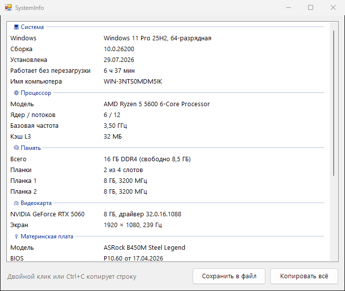

<div align="center">

# 🖥️ SystemInfo

**Все характеристики компьютера на одном экране: процессор, память, видеокарта, диски**




</div>

## ✨ Возможности

- ⚙️ Процессор: модель, ядра и потоки, частота, кэш
- 🧠 Память: объём, тип (DDR4/DDR5), частота, сколько слотов занято и сколько свободно
- 🎮 Видеокарта с реальным объёмом памяти (стандартный способ Windows показывает не больше 4 ГБ), драйвер, разрешение и частота экрана
- 💾 Диски: SSD или HDD, NVMe или SATA, свободное место на каждом разделе
- 🔌 Материнская плата и версия BIOS, сеть, мониторы, версия Windows и время без перезагрузки
- 📋 «Копировать всё» даёт аккуратный текстовый отчёт, который можно отправить в чат или на форум. Серийные номера в отчёт не попадают

## 💡 Когда пригодится

- Проверить, пойдёт ли игра или программа
- Продаёшь или покупаешь компьютер с рук
- Просят «скинуть характеристики» в поддержке или на форуме
- Планируешь апгрейд: сколько слотов под память свободно, какой нужен тип

## 📥 Установка

1. Скачай `SystemInfo.exe` из раздела [**Releases**](../../releases/latest)
2. Запусти его, установка не нужна

## 🛠️ Сборка из исходников

Нужен только Windows: компилятор C# входит в состав .NET Framework.

```bat
build.bat
```

## 📄 Лицензия

[MIT](LICENSE)
